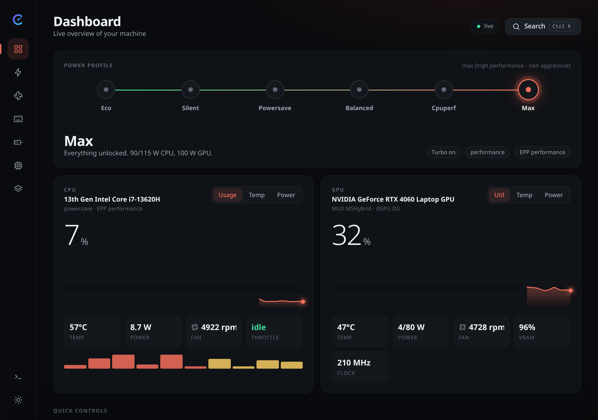
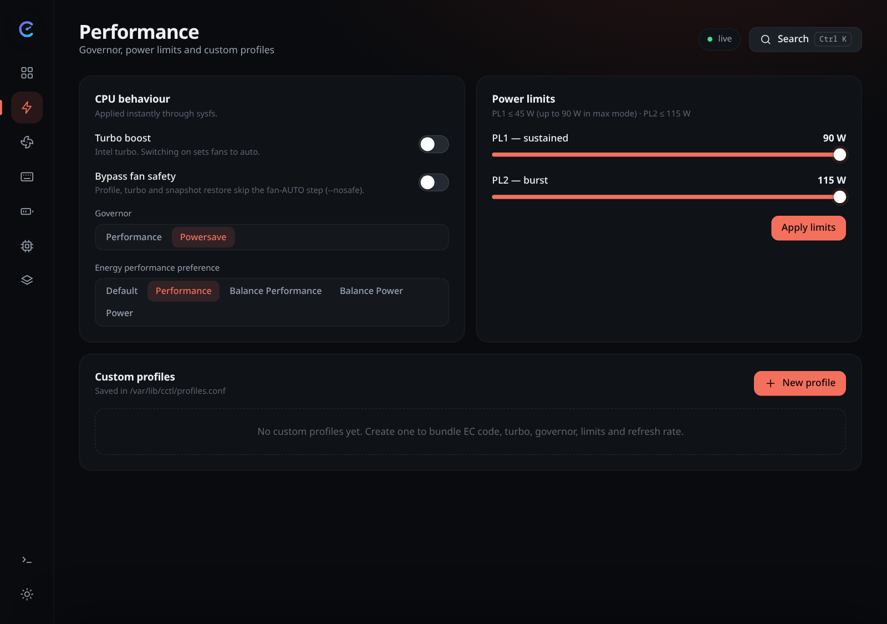
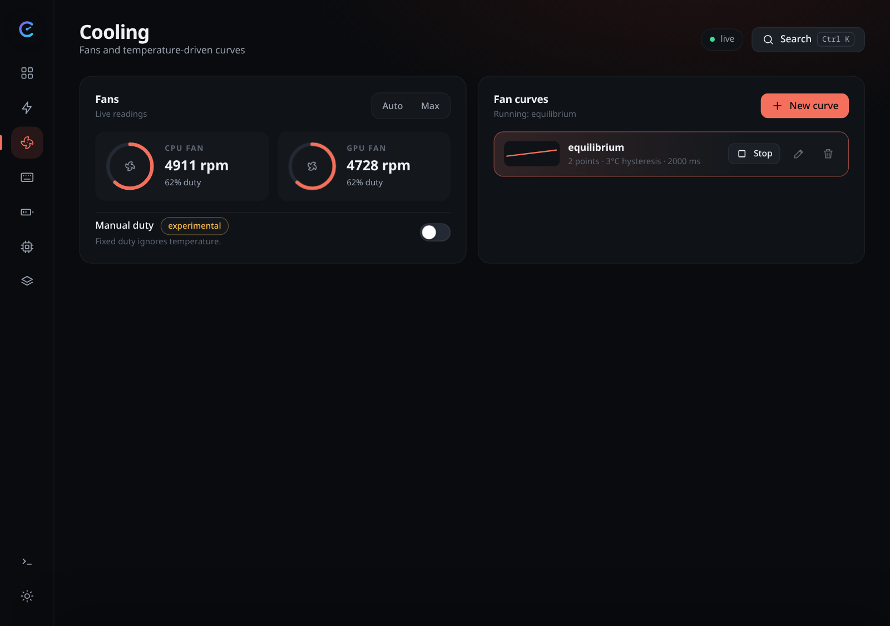
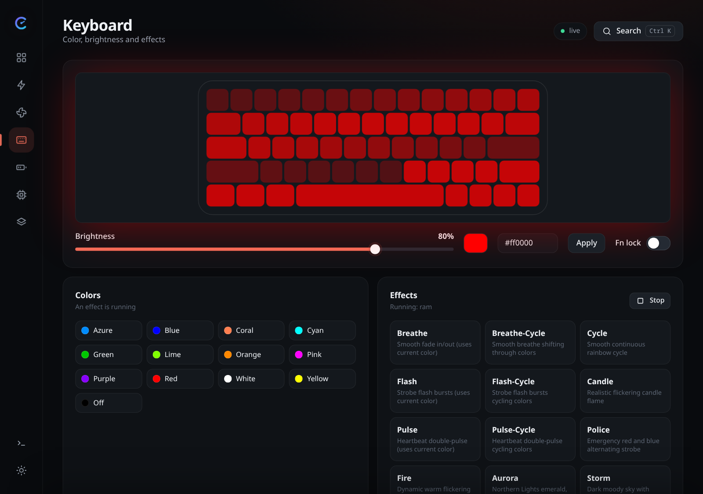
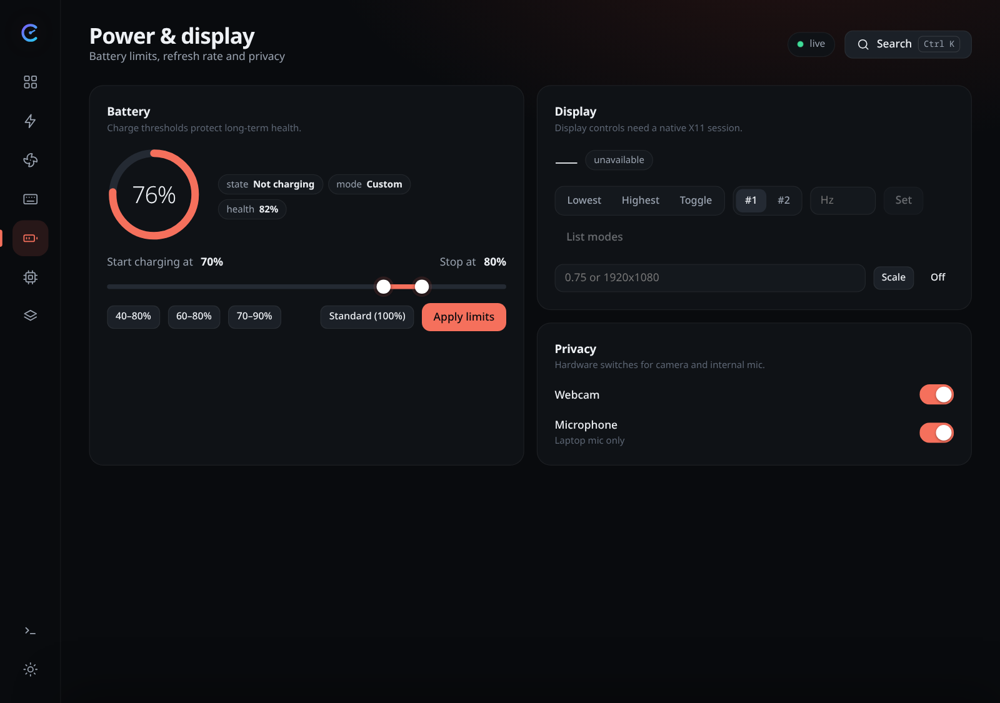
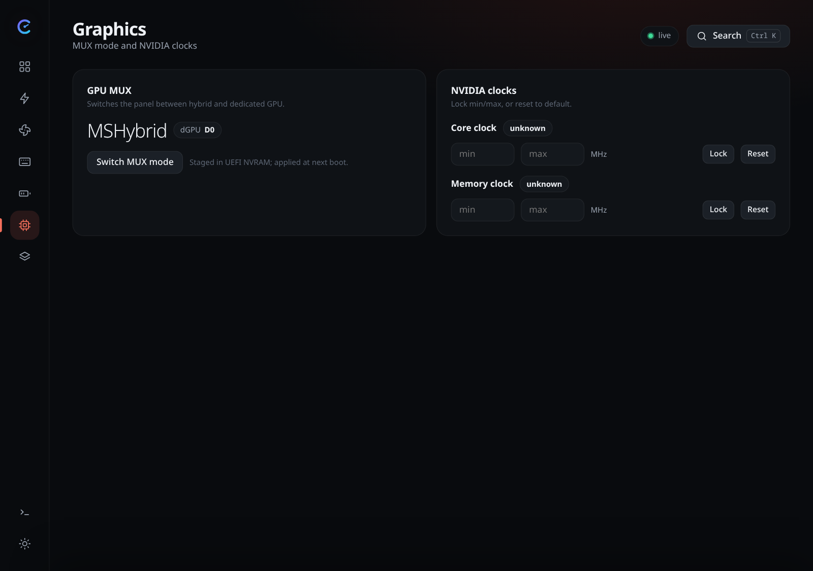
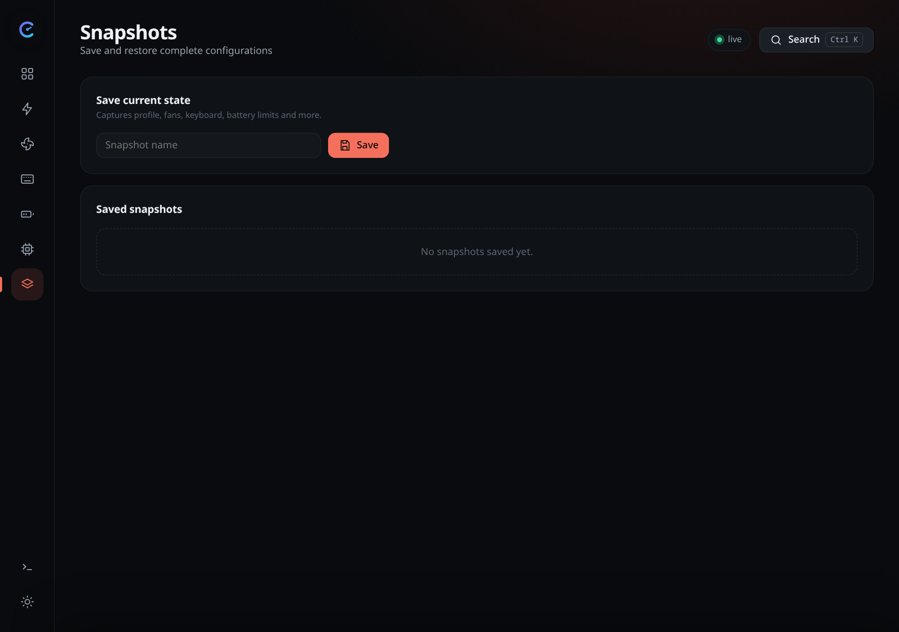
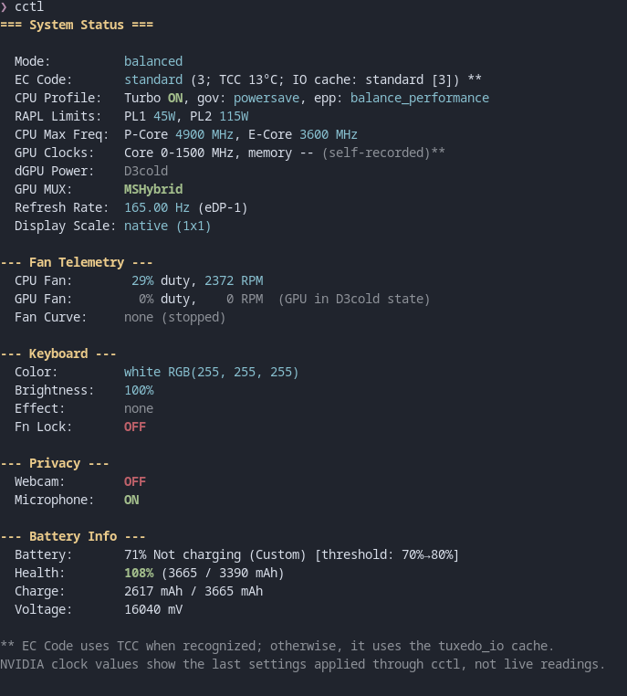
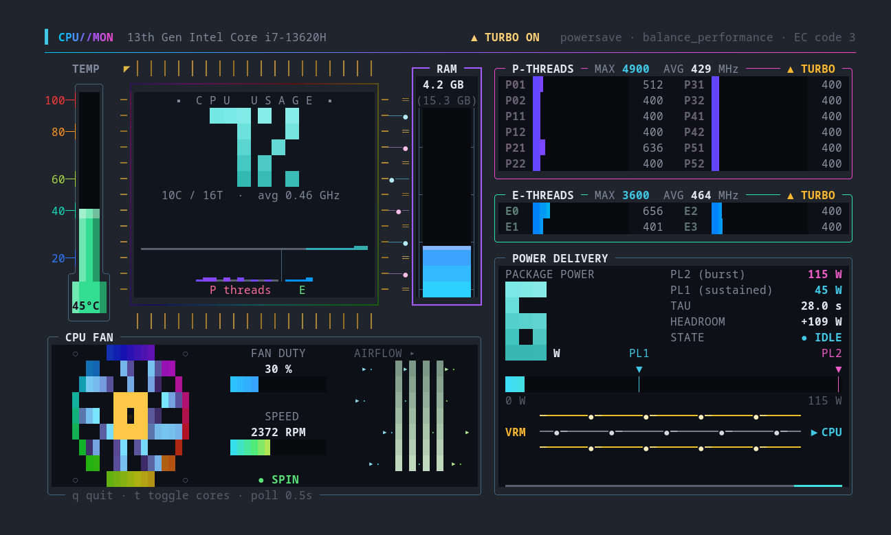
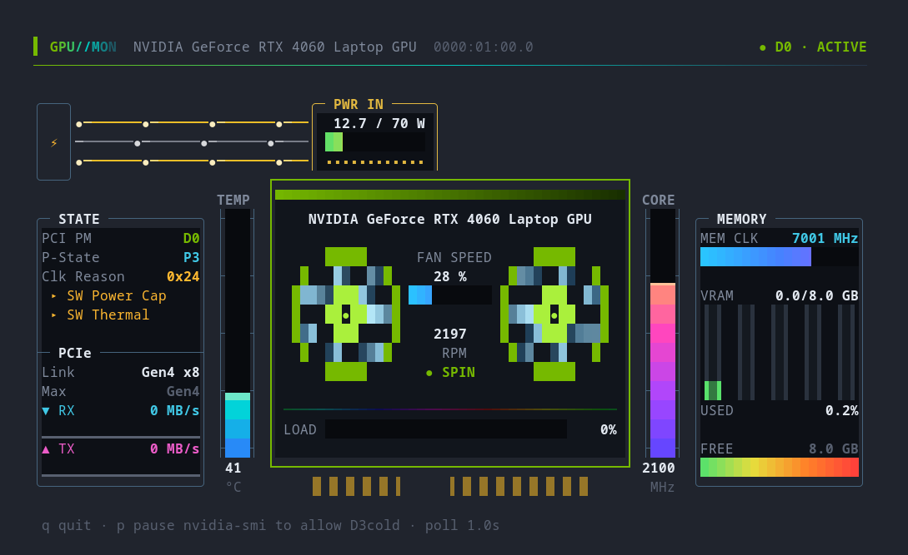

<p align="center">
  
</p>

<h1 align="center">cctl-gui — Linux Control Center for Colorful Laptops</h1>

<p align="center">
  Power profiles, fans, keyboard RGB, battery limits, display, GPU MUX, NVIDIA clocks —<br>
  driven from a browser panel or the terminal, by one small C binary.
</p>

`cctl-gui` is a fork of [bhusann/cctl](https://github.com/bhusann/cctl) that adds
`cctl gui`: a browser control panel served from the same binary at
`http://127.0.0.1:8723/`. Everything the original CLI can do still works exactly
as before — the GUI is just another way to drive it.

---

## What you can control

| Area | Controls |
|---|---|
| Power | Built-in profiles (`set`), custom profiles (`editconf`), CPU turbo, governor, EPP, RAPL PL1/PL2 |
| Fans | Auto / max / silent modes, custom temperature→speed curves (`fancurve`), experimental manual duty |
| Keyboard | Single-zone RGB colors and presets, brightness, animated effects, notification flashes, Fn lock |
| Battery | Charge start/stop thresholds, charge mode, health readout |
| Display | Internal refresh rate, screen scaling |
| Graphics | GPU MUX (hybrid ↔ dedicated, applied at next boot), NVIDIA core/memory clock locks |
| Privacy | Webcam and internal microphone hardware switches |
| Telemetry | Live CPU/GPU monitors (`cpumon`, `gpumon`): usage, temperature, power, fans, per-core clocks, VRAM |
| Config | Snapshots (`snap save/restore`) and boot restore of the last applied config |

## Two ways to drive it

**Browser panel** — `cctl gui` serves the control center on
`http://127.0.0.1:8723/`, no extra dependencies. The page is embedded at build
time from `gui/web/index.html`, so there is still a single binary. Every action
in the panel is a real cctl command executed as a child process, so EC safety
rules (fan-AUTO on EC code 2/3, curve ownership, snapshot semantics) stay
exactly as the CLI enforces them.

```bash
cctl gui              # or: cctl gui --port 9000
```

**CLI** — the original cctl commands, unchanged, and the whole point of the
original design: no GUI, no always-on service. Keyboard effects and fan curves
run a small detached worker only while they are active.

```bash
cctl set balanced     # apply a power profile
cctl fan auto         # fans to automatic control
cctl kbe ram          # keyboard color follows RAM usage
cctl cpumon           # live CPU monitor
cctl status           # all current settings
```

Privileged commands auto-elevate through the passwordless sudoers rule created
by `cctl install` — no manual `sudo` or shell aliases needed.

---

## Browser panel

Seven views, keyboard shortcuts `1`–`7` to switch, `Ctrl K` for a command
palette (type any command, profile, color or effect and run it), a backtick
opens the command log (every action is logged with its real `cctl` command line
and exit code), and a dark/light theme toggle. The accent hue follows the
active power profile.


*Dashboard — live profile dial, CPU/GPU telemetry charts, quick toggles.*


*Performance — turbo, governor, EPP, PL1/PL2 power limits, custom profiles.*


*Cooling — live fan RPM/duty rings and custom fan curves with a graph editor.*


*Keyboard — color presets, brightness, effects (here the `ram` effect, which colors the keyboard by RAM usage).*


*Power & display — battery charge thresholds, refresh rate, privacy switches.*


*Graphics — GPU MUX switching and NVIDIA clock locks.*


*Snapshots — save and restore complete configurations.*

Notes:
* POST requests require an `X-CCTL` header, so random web pages cannot change
  your settings by POSTing to localhost.
* Run the server unprivileged and it elevates per-request through the installed
  binary's sudoers rule; run the systemd service as root and it needs none.
* Endpoint map: [docs/gui.md](docs/gui.md).

## Terminal


*`cctl status` — all current settings at a glance.*


*`cctl cpumon` — live CPU, memory, fan, and power readings.*


*`cctl gpumon` — live NVIDIA GPU readings.*

Full command reference: `cctl --help`, [docs/commands.md](docs/commands.md),
or the embedded agent skill (`cctl --am`).

---

## Install

From this repository (includes the browser GUI and NVIDIA support by default):

```bash
git clone https://github.com/NightEXP34/cctl-gui
cd cctl-gui
./install.sh        # builds, installs to /usr/local/bin, sets up sudoers + boot service
```

Or build manually (needs gcc, pkg-config, and dbus development files):

```bash
make
sudo ./cctl install
```

Install the kernel drivers (required for fans, keyboard, battery, EC profiles):

```bash
cctl drivers-manage
```

Upstream [releases](https://github.com/bhusann/cctl/releases) ship the
CLI-only binary without the GUI panel:

```bash
curl -fsSL https://github.com/bhusann/cctl/releases/latest/download/cctl -o /tmp/cctl \
  && chmod +x /tmp/cctl && sudo /tmp/cctl install
```

To serve the panel at boot and restore your last session on every boot:

```bash
sudo cp systemd/cctl-gui.service /etc/systemd/system/
sudo systemctl enable --now cctl-gui.service
```

---

## Persistence

The panel keeps a last-config record in `/var/lib/cctl/settings`. Every
successful `set`, `turbo`, `fan <auto|max|silent>`, `kbc`, `kbb`, `kbe`,
`fancurve start|stop` records what it applied, and `cctl gui` replays that
record at startup — profile, turbo, fan mode, fan curve, keyboard
color/brightness, and the keyboard effect last (the effect wins over color,
since it owns the keyboard). `--no-restore` skips the replay. Manual fan duty
(`fan cpu|gpu <pct>`) is not recorded, matching snapshots. The replay is logged
to the journal: `journalctl -u cctl-gui`.

Snapshots (`cctl snap save <name>` / `cctl snap restore <name>`) capture
profile, fans, keyboard, battery limits and the active fan curve; restore the
active curve last. Manual fan speeds are not saved.

A running fan-curve worker returns fan control to the laptop before suspend and
resumes the curve after wake (via logind when available; it also resumes when a
monitored temperature rises above 85 °C).

---

## CLI reference

### Power profiles

`set <profile> [--nosafe]` applies EC code + governor/EPP + EC-default TDP:

| Profile | EC code | Turbo | Governor | EPP | EC default TDP | Refresh |
|---|---|---|---|---|---|---|
| max | 2 | ON | powersave | performance | 90/115 W + GPU 100 W | — |
| cpuperf | 3 | ON | powersave | performance | 45/115 W | — |
| balanced | 3 | ON | powersave | balance_performance | 45/115 W | — |
| powersave | 1 | OFF | powersave | balance_power | 15/30 W | lowest |
| silent/eco | 0 | OFF | powersave | power | 15/30 W | — |

Built-in profiles are quick-use presets, not universal recommendations; save
your own with `cctl editconf` (see the
[custom profiles guide](docs/custom-profiles.md)). Full-load measurements:
[EC profile test results](docs/ec-profile-test-results.md).

### Commands

| Group | Commands |
|---|---|
| Profiles & setup | `set`, `editconf`, `install`, `uninstall`, `drivers-manage` |
| Keyboard & fans | `kbc`, `kbb`, `kbe`, `kbn`, `fn`, `fan`, `fancurve` (alias `fanc`) |
| GPU & privacy | `mux`, `nvidia clock`, `nvidia memclock`, `webcam`, `mic` |
| Battery & info | `bat`, `status`, `--version` |
| Monitors | `cpumon`, `gpumon` |
| Display | `rr`, `scale` |
| CPU controls | `turbo`, `gov`, `epp`, `rapl` |
| Snapshots | `snap` / `snapshot` (`save`, `restore`, `view`, `delete`) |
| Panel & options | `gui`, `options` (streamed output, bare `cctl` default) |
| Help & skill | `--help`, `--am` |

### Safety rules

* Applying EC profile code `2` or `3`, or enabling Turbo while EC code `2`/`3`
  is active, sets fans to **AUTO** by default — silent fan modes and manual
  duty can keep fans quiet under load. `--nosafe` skips that automatic change.
* Manual fan duty below 25% needs admin mode and is experimental: fixed duty
  ignores temperature and may cause overheating.
* Do not run TCC (`tccd`), NBFC, or another Clevo fan daemon alongside cctl —
  they fight over fan speed and profile state (`sudo systemctl stop tccd`).

---

## Hardware compatibility

Built for the **Colorful Evol P15** series (Clevo/TUXEDO chassis).

| Laptop | CPU | GPU | Keyboard |
|---|---|---|---|
| Colorful Evol P15 | Intel Core i7-13620H | RTX 4060 Mobile 100 W | Single-zone RGB |
| Colorful Evol P15 | Intel Core i5-12500H | RTX 4050 Mobile 100 W | Single-zone RGB |

Other Clevo/TUXEDO variants may have different EC register layouts, fan byte
orders, or profile codes — use at your own risk.

---

## Kernel drivers

The Clevo/TUXEDO stack (`clevo_acpi`, `tuxedo_keyboard`, `tuxedo_io`) backs fan
control, keyboard backlight, battery thresholds, and EC profiles. `cctl install`
handles DKMS registration; `cctl drivers-manage` installs or removes them.

Driver sources live only in the mirror repo
[bhusann/tuxedo-drivers-cctl-mirror](https://github.com/bhusann/tuxedo-drivers-cctl-mirror)
(readable `drivers/` folder plus the pre-packed `drivers.tar.gz`, attached to
every cctl release). They can also be installed without cctl:

```bash
git clone https://github.com/bhusann/tuxedo-drivers-cctl-mirror
sudo tuxedo-drivers-cctl-mirror/drivers/driverinstall.sh --install
sudo tuxedo-drivers-cctl-mirror/drivers/driverinstall.sh --uninstall
tuxedo-drivers-cctl-mirror/drivers/driverinstall.sh --status   # no root needed
```

Supported package managers (auto-installs `dkms` + kernel headers if missing):
`pacman` (Arch, Manjaro, EndeavourOS, CachyOS — tested on Arch and CachyOS),
`apt`, `dnf`, `zypper`, `xbps`, `emerge`, `eopkg`. Atomic/immutable Fedora
editions (Silverblue, Bazzite, …) are not supported: DKMS modules cannot
persist on a read-only root.

> **Secure Boot caution:** These kernel modules are installed unsigned. If Secure Boot is enabled, they may fail to load and the laptop may not boot normally. Disable Secure Boot for normal booting, or refer to your OS distribution's wiki for signing the modules and enabling Secure Boot again, if you wish.

Manual DKMS registration and in-place compilation are documented in [MANUAL_INSTALL.md](https://github.com/bhusann/tuxedo-drivers-cctl-mirror/blob/main/MANUAL_INSTALL.md).

> **Immutable / Atomic OS note:** Atomic and immutable editions such as Fedora Silverblue/Kinoite/Atomic Desktops/Bazzite (`rpm-ostree`) and openSUSE MicroOS/Aeon (`transactional-update`) are **not supported**, because the root filesystem is read-only and DKMS modules cannot persist across image updates. On unrecognized distros, the installer points to the driver source in the [mirror repo](https://github.com/bhusann/tuxedo-drivers-cctl-mirror) for manual installation.

---

## Updating and uninstalling

**Update:** rebuild and run `sudo ./cctl install` (confirm with `y`; choose
sudo scope: current user only, default, or all users).

**Uninstall:** drivers first, then cctl, so cctl is still available for clean
driver removal:

```bash
sudo cctl drivers-manage   # select the uninstall option
sudo cctl uninstall        # type "yes" — removes binary, sudoers rule, profiles, /var/lib/cctl data
```

Manual cleanup: [docs/manual_uninstall.md](docs/manual_uninstall.md).

---

## Build

```bash
make                # standard build: GUI + NVIDIA compiled in (-DCCTL_GUI -DCCTL_NVIDIA)
make install        # build and install through cctl's installer
make clean
```

`CC`, `CFLAGS`, and `LDFLAGS` are respected (appended); hardening flags are
always applied. `STRIP=0` keeps debug symbols. The web UI and icon are embedded
at build time by `tools/gen_gui_html.py` from `gui/web/index.html` and
`docs/cctl-icon.svg`; the agent skill is embedded from `SKILL.md`.

`upstream` points at bhusann/cctl for rebases; the CLI itself is untouched
apart from the additions above.

---

## Documentation

| Doc | Contents |
|---|---|
| [docs/gui.md](docs/gui.md) | HTTP endpoint map and startup replay |
| [docs/commands.md](docs/commands.md) | Full CLI usage, options, fan-curve details |
| [docs/custom-profiles.md](docs/custom-profiles.md) | Custom profile fields and examples |
| [docs/ec-profile-test-results.md](docs/ec-profile-test-results.md) | EC profile load-test measurements |
| [docs/developer-notes.md](docs/developer-notes.md) | Internals |
| [docs/manual_uninstall.md](docs/manual_uninstall.md) | Manual removal steps |
| [SKILL.md](SKILL.md) | Agent skill (`cctl --am`) |

---

## License and credits

`cctl` code is MIT — see [LICENSE](LICENSE). Copyright (c) 2026 bhusann; fork
changes are MIT as well.

Kernel driver code is **GPL-2.0-or-later**, derived from the
[TUXEDO Linux drivers](https://github.com/tuxedocomputers/tuxedo-drivers)
project (copyright TUXEDO Computers GmbH and contributors) — see the mirror
repo's `drivers/LICENSE` and [docs/THIRD-PARTY-NOTICES](docs/THIRD-PARTY-NOTICES).

GPU MUX reverse-engineering findings referenced from
[arbitrary-string/clevo-control-panel](https://github.com/arbitrary-string/clevo-control-panel).

> Upstream credit: the original `cctl` was created with AI assistance under
> human direction, and thoroughly tested and evaluated by a human.
